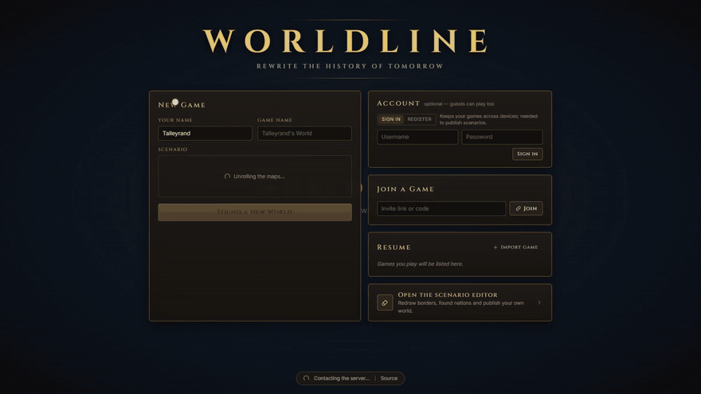

# Worldline

**An AI-driven grand-strategy game in the browser.** Pick a nation, write your orders in plain language, and a language model plays the rest of the world, while a rules engine keeps it honest.

[](https://github.com/gazarrillo/worldline/actions/workflows/ci.yml)
[](LICENSE)
[](https://bun.sh)



<sub>Recorded with a live model (OpenRouter's free models with a DeepSeek fallback); waiting for the turn to resolve is cut and the typing is sped up.</sub>

Worldline starts on 1 January 2026 (or 1 October 1962, or any world you build in the editor) on a political map in the style of Victoria 3. Each turn you and your friends give orders such as "open talks with Brazil on a rail corridor", "move two divisions to the border" or "call a snap election". An AI World Director plans what every other government does, a resolver turns everyone's orders into events, and a deterministic rules engine checks every effect before it touches the map: it refuses or scales down anything the world's state doesn't allow.

It runs entirely on your machine. Without an API key it uses an offline mock, so you can try every feature for free; with a key it works with OpenRouter, Anthropic, OpenAI, Gemini or any local OpenAI-compatible model.

## Features

- **Free-text orders, validated outcomes.** The AI writes the story; the rules engine in `packages/shared` decides what actually changes: borders, stability, economies, armies, treaties.
- **Multiplayer with friends.** Share an invite link; everyone plays a nation in the same world. Spectators and players whose nation fell can take over another one mid-game.
- **Diplomacy.** One-to-one chats and multi-nation conferences with AI governments, which also write first when events give them a reason. Organisations hold votes with real rules (UN Security Council veto, EU qualified majority, NATO consensus).
- **War.** Battle plans with offensive arrows and hold lines, front lines, peace negotiations, surrender and nuclear escalation, all checked by the rules engine.
- **Living governments.** Elections and other scheduled dates, leaders who can fall, governments that collapse and are succeeded, nations formed when the AI judges it realistic.
- **Projects.** Orders that take more than one turn (a rail network, a reform, a military build-up) become projects with milestones and a due date.
- **Advisor.** Answers your questions in letters, with a small chart when numbers help.
- **Time travel.** The host can rewind to any earlier turn, or stop a turn at a chosen event and intervene.
- **Scenario editor.** Paint regions, edit nations and publish your own starting worlds at `/editor`.
- **Saved games.** Export a whole game, with every turn, as one JSON file and import it as a new game.

## Screenshots

<table>
  <tr>
    <td colspan="2">
      
      <br><sub><b>The world in 2026.</b> 201 nations on a map generated from Natural Earth data, drawn in WebGL2.</sub>
    </td>
  </tr>
  <tr>
    <td width="50%">
      
      <br><sub><b>Orders and diplomacy.</b> Last turn's verdicts on the left, a negotiation with France on the right.</sub>
    </td>
    <td width="50%">
      
      <br><sub><b>Turn report.</b> How each order went, what changed for your nation, and what happened in the world.</sub>
    </td>
  </tr>
  <tr>
    <td width="50%">
      
      <br><sub><b>Lobby.</b> Claim a nation by clicking the map; the host sets difficulty, turn length and the model chain.</sub>
    </td>
    <td width="50%">
      
      <br><sub><b>Map modes.</b> Relations, organisations, wars, GDP, stability and power rank, here relations with Germany.</sub>
    </td>
  </tr>
  <tr>
    <td width="50%">
      
      <br><sub><b>Close up.</b> Provinces stay sharp when zoomed in, over Natural Earth shaded relief.</sub>
    </td>
    <td width="50%">
      
      <br><sub><b>Scenario editor.</b> Repaint borders, edit nations and save your own starting world.</sub>
    </td>
  </tr>
</table>

<sub>These screenshots were taken with the offline mock AI, so their event and chat text is simpler than a real model writes; the animation above shows a live model.</sub>

## Quick start

You need [Bun](https://bun.sh) 1.3 or later.

```bash
git clone https://github.com/gazarrillo/worldline.git
cd worldline
bun install
bun run dev
```

Open http://localhost:5173. The game server runs on port 3001, and the client proxies `/api` and `/ws` to it.

That's enough to play with the offline mock AI. To play against a real model, copy `.env.example` to `.env` in the repository root and set one key, for example:

```bash
OPENROUTER_API_KEY=sk-or-...
```

The default model chain uses OpenRouter's free models, falling back to a cheap paid model only when they all fail. The host picks the chain in the lobby. See [docs/ai.md](docs/ai.md) for every backend, cost and speed figures, and tuning options.

### Playing with friends

Forward port 5173 with VS Code's Ports panel (visibility: Public) or a Cloudflare quick tunnel, then share the invite link:

```bash
cloudflared tunnel --url http://localhost:5173
```

Vite already allows `*.devtunnels.ms`, `*.trycloudflare.com` and ngrok hosts. Everyone in your games uses the server's AI keys and quota.

## How a turn works

1. When a turn opens, the **World Director** plans what AI governments will do. This doesn't depend on players' orders, so it starts straight away.
2. Players write orders, chat with other nations and press ready.
3. Organisations vote on tabled resolutions under their own rules.
4. The **resolver** turns everyone's orders, the Director's plans and the votes into events, each carrying structured effects.
5. The **rules engine** validates every effect against the world's state and applies what it allows. Refused and scaled-down effects are listed in the next turn's prompt, so the model's picture of the world doesn't drift from the map.
6. The simulation advances economies and stability over the period, and governments at rock bottom collapse. Each player then sees only what their nation would know.

Long games stay bounded: chronicles are summarised every 5 turns and folded into one "earlier history" entry.

## Repository layout

```
apps/web/            Vite + React client; WebGL2 map renderer in src/map/, HUD in src/ui/
apps/server/         Bun server: rooms + WebSocket (src/rooms.ts), SQLite saves (src/db.ts),
                     game engine and prompts (src/engine/), AI backends + mock (src/ai/)
packages/shared/     Game state, rules engine (validates every AI effect), votes, sim, protocol
packages/mapdata/    Generated base map (province bitmap, borders, metadata) served at /map/*
packages/scenarios/  Scenario starts: modern-2026 and cold-war-1962
tools/mapgen/        Offline pipeline: Natural Earth → province bitmap + metadata
docs/                AI backends and the map pipeline in detail
```

## Development

```bash
bun test             # rules engine, sim, votes, AI schemas, turn pipeline, multiplayer, …
bun run typecheck    # every workspace
bun run ai:smoke     # end-to-end check against the live AI (about 5 requests)
```

Tests always use the offline mock AI, so they need no keys and spend nothing. The generated map files are committed; you only need to rebuild them if you change the map pipeline, as described in [docs/map-pipeline.md](docs/map-pipeline.md).

## Contributing

Contributions are welcome: bug reports, scenarios, rules, UI, map work and docs. Read [CONTRIBUTING.md](CONTRIBUTING.md) to get set up, and note that we ask contributors to sign a [Contributor License Agreement](CLA.md) on their first pull request. Everyone taking part is expected to follow the [Code of Conduct](CODE_OF_CONDUCT.md).

Found a security issue? Please report it privately as described in [SECURITY.md](SECURITY.md).

## License

Worldline is free software under the [GNU Affero General Public License v3.0](LICENSE). You may use, study, modify and share it. If you run a modified version as a service that other people use over a network, the AGPL requires you to offer them its source code. The main menu links to the source; set `VITE_SOURCE_URL` to your own repository when you run the client from a fork.

Copyright © 2026 gazarrillo and contributors.

## Credits

- Map data: [Natural Earth](https://www.naturalearthdata.com) (public domain): admin-0 countries, admin-1 provinces, lakes and shaded relief.
- Economic statistics: [World Bank Open Data](https://data.worldbank.org) ([CC BY 4.0](https://creativecommons.org/licenses/by/4.0/)).
- Flags: [flag-icons](https://github.com/lipis/flag-icons) (MIT).
- Fonts: [Inter](https://rsms.me/inter/) and [Cinzel](https://fonts.google.com/specimen/Cinzel) (SIL Open Font License 1.1).

Worldline is not affiliated with Paradox Interactive or any government it depicts. Scenarios describe real countries and public figures for the purposes of a game; what happens in your world is fiction.
